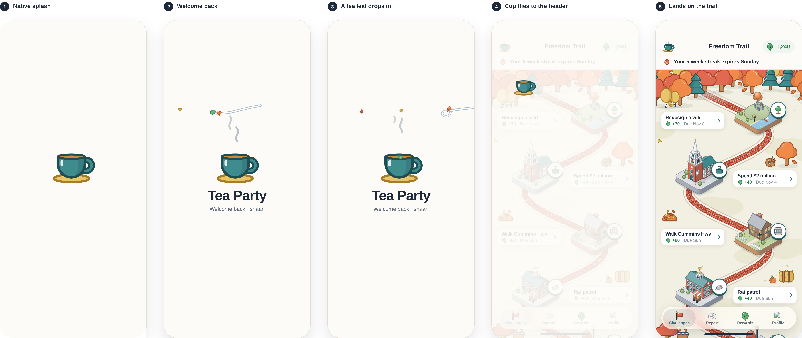

# Launch: no sign-in, straight to the trail

There are no accounts yet: the app runs as the seed user (Ishaan), so there's no welcome page with a button. Opening the app is a 2.3 s moment that lands on the Challenges tab. It also plays on cold starts only, never when switching tabs.



## 1 · Native splash (static, shown by iOS/Android while JS loads)
Cream background, the teacup centered. It must match frame 2 exactly so the hand-off is invisible.

`app.json → plugins → expo-splash-screen`:
```json
{ "backgroundColor": "#FCFBF8", "image": "./assets/images/splash-icon.png", "imageWidth": 120 }
```
Use `design/assets/launch/splash-icon.png` (teacup, transparent, 1024²). App icon: `assets/launch/icon.png` (1024², no alpha). Android adaptive: `android-icon-foreground/background/monochrome.png`, background color `#F6F1E7`. Web: `favicon.png`.

## 2 · Welcome (0 – 1.6 s), over a cream overlay
| t (s) | What happens |
|---|---|
| 0.05 | Two steam wisps start rising from the cup and loop (dash 40/200 sweeping up, 1.6 s, second wisp +0.35 s) |
| 0.25 | **Tea Party** (Bricolage 800, 38, ink) rises 10 px and fades in (0.45 s ease-out) |
| 0.50 | "Welcome back, Ishaan" (DM Sans 15, slate) does the same. Use the seed profile's first name |
| 0.35 | One gust sweeps across above the cup (same style as the trail gusts, 1.3 s) with 3 leaves riding it |
| 0.70 | A green tea leaf drops along a curve into the cup (0.55 s), shrinking as it lands |
| 1.22 | A white ring ripples on the tea (0.5 s) |

## 3 · Hand-off (1.5 – 2.3 s)
- 1.50: wordmark and greeting fade out (0.25 s).
- 1.60: the cup flies to the header's teacup: translate to (36, 72) and scale to 32/120, 0.5 s `cubic-bezier(.5,0,.3,1)`, then fades as it meets the real header cup.
- 1.75: the cream overlay fades out (0.5 s), revealing the Challenges tab underneath, already laid out at the top of the trail.
- 2.30: overlay removed. Taps anywhere during the animation skip straight to the end.

Coordinates are on the 402 × 874 frame; scale by screenWidth/402. The overlay sits above the tab bar. With Reduce Motion: show frame 1 for 300 ms, then cross-fade to the tab.

## Paths
- Gust: `M-30 250 C 60 232, 120 270, 196 250 S 300 228, 330 242 c 14 8 4 26 -10 21 c -10 -3 -7 -15 5 -13 C 360 246, 400 236, 450 242`
- Tea-leaf drop: `M96 170 C 150 196, 112 268, 168 312 S 204 366, 197 384` (ends on the tea surface)
- Cup: 120 × 120 box centered at (201, 392); `assets/launch/teacup-mark.svg` is the same mark.
